# 代表20品・画像プレビュー

すべて新規制作したAI生成の盛り付けイメージです。画像を選択すると640px版を確認できます。制作・権利の記録は [IMAGE_GUIDE.md](IMAGE_GUIDE.md) と [画像台帳](data/image-manifest.json) を参照してください。

| 料理 | 料理 | 料理 | 料理 |
| --- | --- | --- | --- |
| [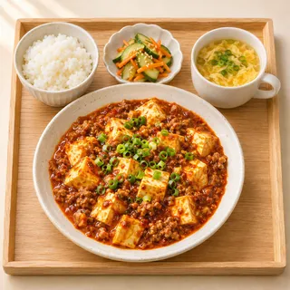](assets/images/mapo.webp) 四川風麻婆豆腐 | [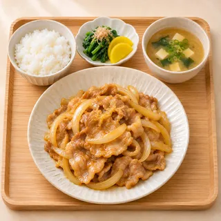](assets/images/ginger.webp) 豚の生姜焼き | [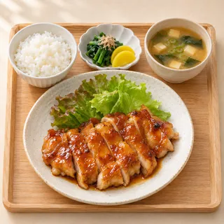](assets/images/chicken.webp) 鶏の照り焼き | [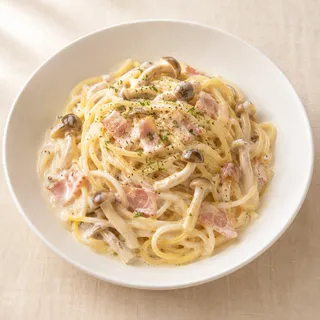](assets/images/pasta.webp) きのこクリームパスタ |
| [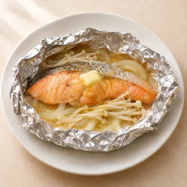](assets/images/salmon.webp) 鮭のホイル焼き | [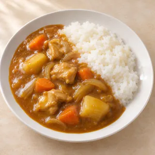](assets/images/curry.webp) チキンカレー | [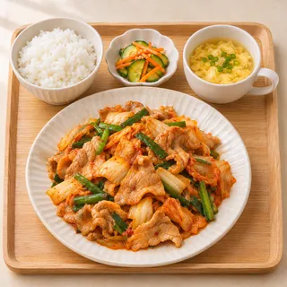](assets/images/chili.webp) 豚キムチ炒め | [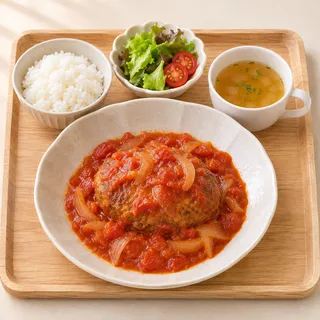](assets/images/hamburg.webp) 煮込みハンバーグ |
| [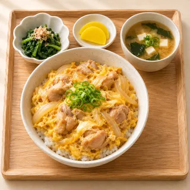](assets/images/oyako.webp) 親子丼 | [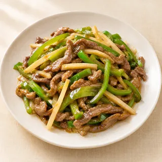](assets/images/pepper.webp) 青椒肉絲 | [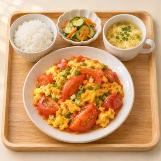](assets/images/tomato.webp) トマトと卵の中華炒め | [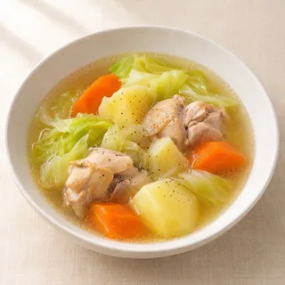](assets/images/stew.webp) 鶏と野菜のポトフ |
| [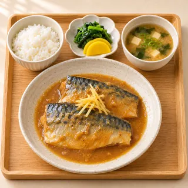](assets/images/saba_miso.webp) さばの味噌煮 | [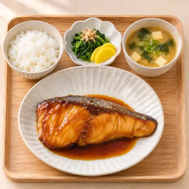](assets/images/buri.webp) ぶりの照り焼き | [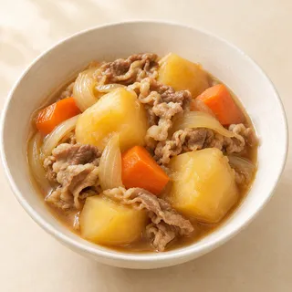](assets/images/nikujaga.webp) 肉じゃが | [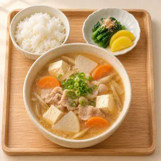](assets/images/tonjiru.webp) 具だくさん豚汁 |
| [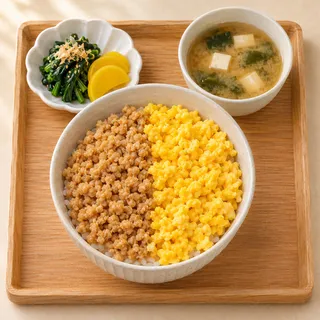](assets/images/soboro.webp) 鶏そぼろ丼 | [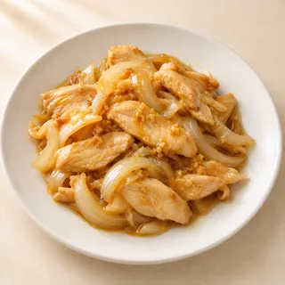](assets/images/shogayaki_chicken.webp) 鶏むね肉の生姜焼き | [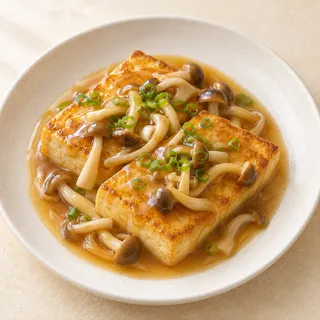](assets/images/tofu_steak.webp) 豆腐ステーキきのこあん | [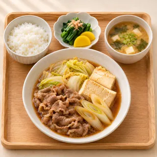](assets/images/sukiyaki.webp) 牛肉と豆腐のすき煮 |
