# 料理写真プレビュー（全60品）

副菜を添えてお盆に載せた定食風の、AI生成の盛り付けイメージです（2026-11-14 取り込み）。副菜は飾りで、レシピ・買い物リスト・栄養値には含みません。画像を選択すると640px版を確認できます。制作・権利の記録は [IMAGE_GUIDE.md](IMAGE_GUIDE.md) と [画像台帳](data/image-manifest.json) を参照してください。「※作り直し推奨」の理由は画像台帳の `review.note` にあります。

| 料理 | 料理 | 料理 | 料理 |
| --- | --- | --- | --- |
|  四川風麻婆豆腐 |  豚の生姜焼き |  鶏の照り焼き |  きのこクリームパスタ |
|  鮭のホイル焼き |  チキンカレー |  豚キムチ炒め |  煮込みハンバーグ |
|  親子丼 |  青椒肉絲 |  トマトと卵の中華炒め |  鶏と野菜のポトフ |
|  さばの味噌煮 |  ぶりの照り焼き |  肉じゃが |  具だくさん豚汁 |
|  鶏そぼろ丼 |  鶏むね肉の生姜焼き |  豆腐ステーキきのこあん |  牛肉と豆腐のすき煮 |
| [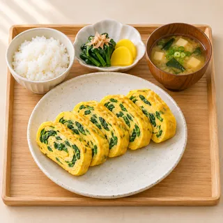](assets/images/tamagoyaki.webp) ほうれん草入り卵焼き ※作り直し推奨 | [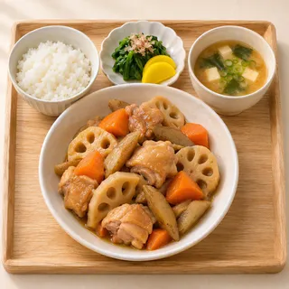](assets/images/chikuzen.webp) 筑前煮 | [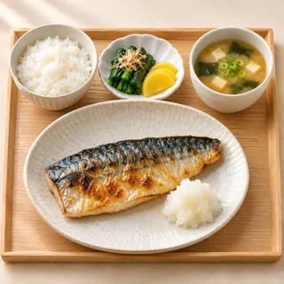](assets/images/saba_shio.webp) さばの塩焼き | [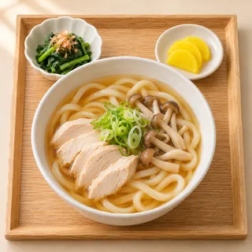](assets/images/udon.webp) 鶏ときのこの温うどん |
| [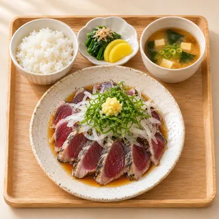](assets/images/katsuo.webp) かつおのたたき香味だれ | [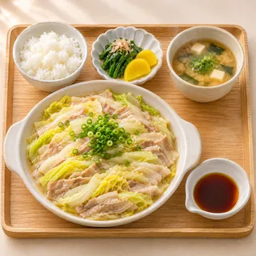](assets/images/nabe.webp) 白菜と豚肉の重ね蒸し | [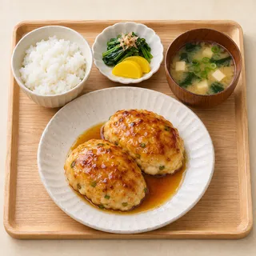](assets/images/tofu_hamburg.webp) 豆腐入り鶏ハンバーグ ※作り直し推奨 | [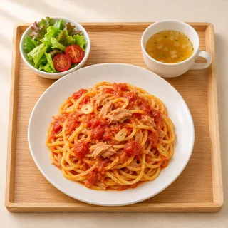](assets/images/tuna_pasta.webp) ツナとトマトのパスタ |
| [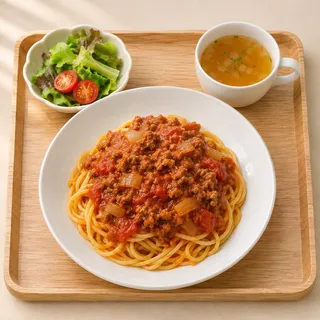](assets/images/bolognese.webp) ミートソーススパゲティ | [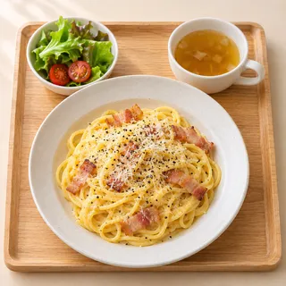](assets/images/carbonara.webp) カルボナーラ | [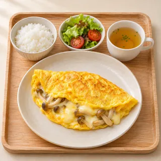](assets/images/omelet.webp) きのこのチーズオムレツ | [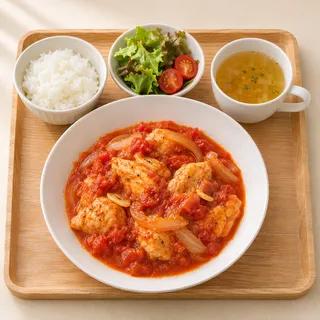](assets/images/chicken_tomato.webp) 鶏肉のトマト煮 |
| [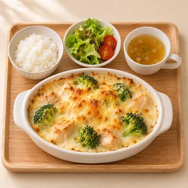](assets/images/gratin.webp) 鶏とブロッコリーのグラタン | [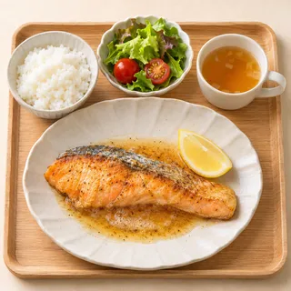](assets/images/salmon_muniere.webp) 鮭のムニエル | [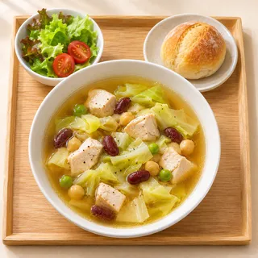](assets/images/chicken_soup.webp) 鶏むね肉と豆のスープ | [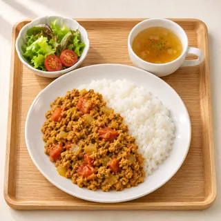](assets/images/keema.webp) キーマカレー |
| [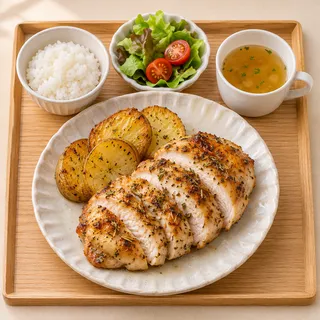](assets/images/chicken_herb.webp) チキンのハーブ焼き | [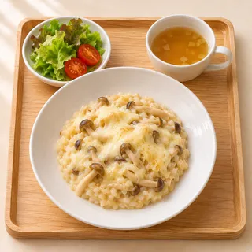](assets/images/risotto.webp) きのことチーズのリゾット | [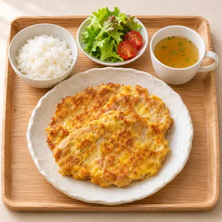](assets/images/pork_piccata.webp) 豚肉のピカタ ※作り直し推奨 | [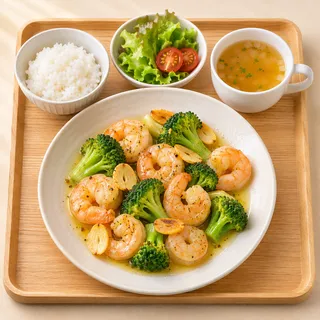](assets/images/shrimp_garlic.webp) えびのガーリックソテー |
| [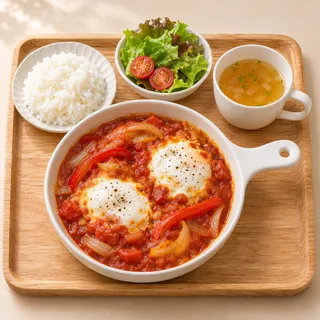](assets/images/shakshuka.webp) トマトと卵の煮込み | [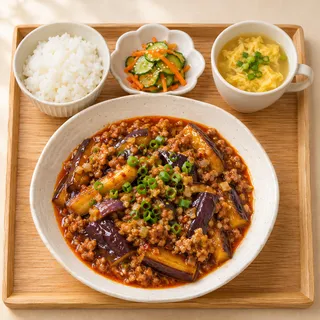](assets/images/mapo_nasu.webp) 麻婆なす | [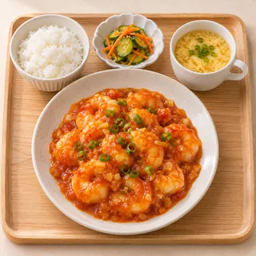](assets/images/ebichili.webp) エビチリ | [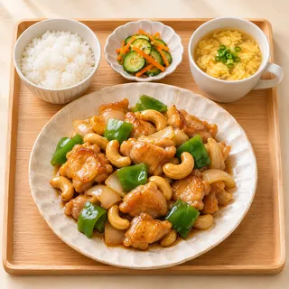](assets/images/chicken_cashew.webp) 鶏肉とカシューナッツ炒め ※作り直し推奨 |
| [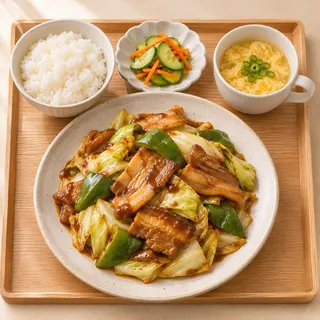](assets/images/hoikoro.webp) 回鍋肉 | [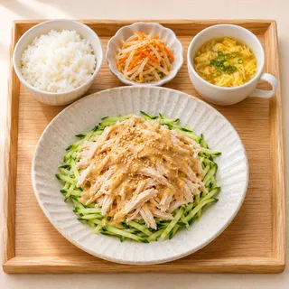](assets/images/banbanji.webp) 棒棒鶏 | [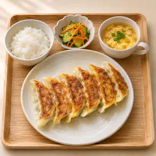](assets/images/gyoza.webp) 焼き餃子 | [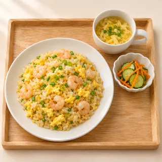](assets/images/chahan.webp) えびと卵のチャーハン |
| [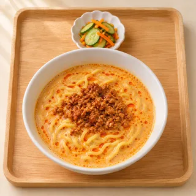](assets/images/tantan.webp) 豆乳担々麺 | [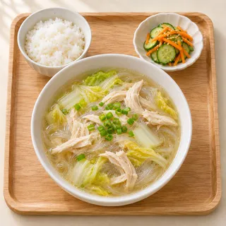](assets/images/harusame.webp) 鶏と春雨の中華スープ | [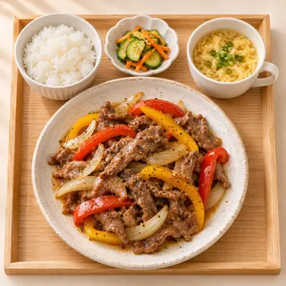](assets/images/blackpepper.webp) 牛肉の黒胡椒炒め | [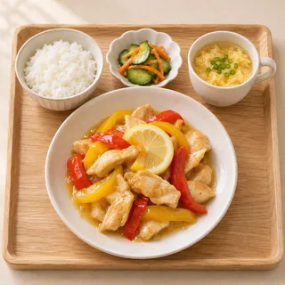](assets/images/chicken_lemon.webp) 鶏肉のレモン炒め |
| [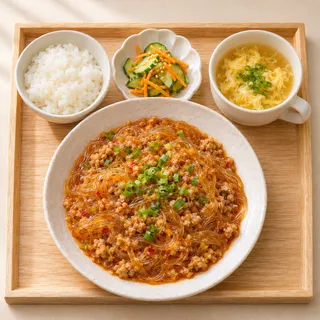](assets/images/mapo_harusame.webp) 麻婆春雨 | [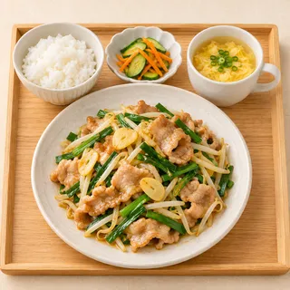](assets/images/garlic_pork.webp) にんにく香る豚ニラ炒め | [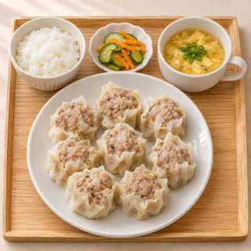](assets/images/shumai.webp) 簡単シュウマイ | [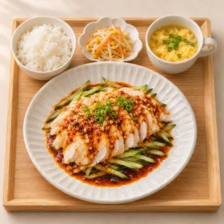](assets/images/spicy_chicken.webp) よだれ鶏 |
| [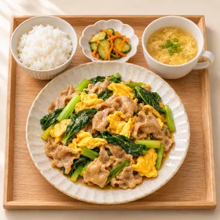](assets/images/pork_egg.webp) 豚肉と卵のオイスター炒め | [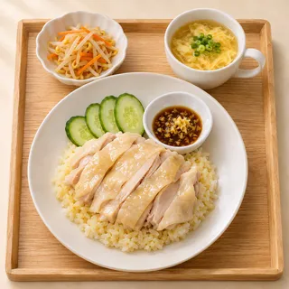](assets/images/chicken_rice.webp) 海南鶏飯風チキンライス | [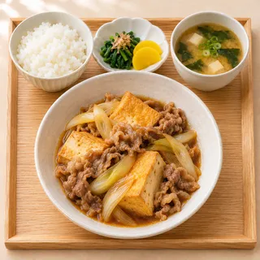](assets/images/beef_tofu.webp) 牛肉と厚揚げの甘辛煮 | [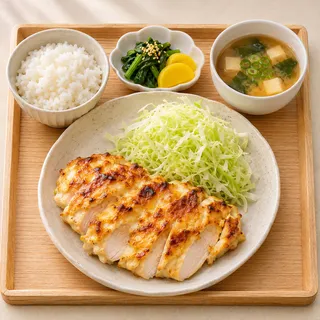](assets/images/chicken_miso.webp) 鶏むね肉の味噌マヨ焼き |
